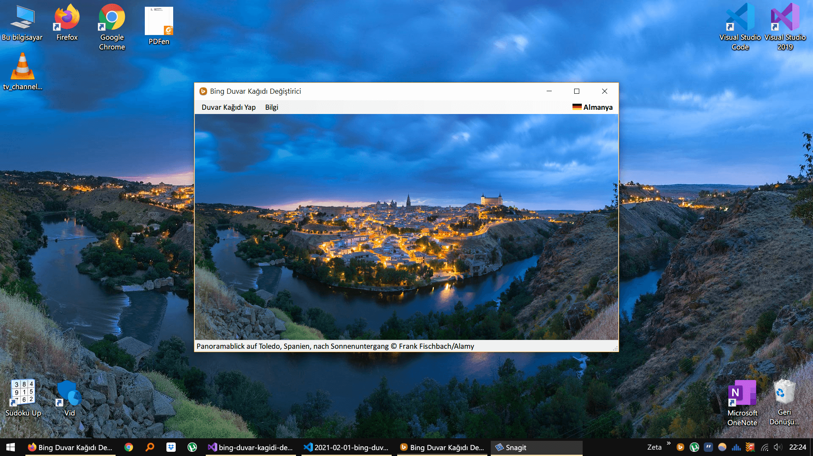

{:.resim-ortali}

Bing arama motoru her gün dünyanın farklı yerlerinden yeni bir fotoğraf seçiyor. Bu program, o günün fotoğrafını Bing’in resmi sitesinden indirip bilgisayarınızın duvar kağıdı yapıyor. Hiçbir ayar yapmanıza gerek kalmadan ekran boyutunuzu kendisi algılıyor ve fotoğrafı o boyutta indiriyor.

Cep telefonumda her gün belirli bir saatte duvar kağıdını değiştiren bir uygulamayı çok sevmiştim. Aynı keyfi bilgisayarımda da yaşamak için bu programı Windows için yazdım.

**Neler yapabilir?**

- Bing’in farklı ülkelerdeki sayfalarından **(Almanya, Amerika, Avustralya, Brezilya, Britanya, Fransa, Hindistan, Japonya, Kanada, Türkiye, Yeni Zelanda)** günün fotoğrafını indirir.
- İndirilen fotoğrafı tek tıkla duvar kağıdı yapar.
- Ekran çözünürlüğünü kendisi algılar ve o boyutta fotoğraf indirir.
- Fotoğrafları bilgisayarda saklar; aynı gün için tekrar indirmez.
- Yeni bir sürüm çıktığında bunu kontrol eder ve güncelleme adresini gösterir.

**Nasıl kullanılır?**

1. Programı açın; ülke ve çözünürlük ayarlarını seçin.
2. Günün duvar kağıdını indirin.
3. Duvar kağıdını uygulayın.

Windows 10 veya 11 (64 bit) bilgisayarınızda ek bir kurulum gerektirmeden çalışır. Bu proje artık geliştirilmiyor; yine de çalışmaya devam ediyor.

{:.tablo-ortali}
| Bing Duvar Kağıdı Değiştirici     |  Proje ve Kaynak Kod  |
|---------------------------------------------|-------------------------------------------|
| **Gereksinimler**: Windows 10 (17763) veya üzeri, internet bağlantısı | **Programlama Dili**: C# (.NET 10) |
| **Platform**: Microsoft Windows (64 bit) | **GitHub Sayfası**: [Link](https://github.com/Umut-D/Bing-Duvar-Kagidi-Degistirici){:target="_blank"} |
| **İndir**: [Link](https://www.dropbox.com/s/74blhl4c1l5u7p0/bing-duvar-kagidi-degistirici.zip?dl=1) | **Proje**: [Link](https://github.com/Umut-D/BingDuvarKagidiDegistirici/archive/refs/tags/v3.0.0.zip/bing-duvar-kagidi-degistirici-proje.zip?dl=1) |